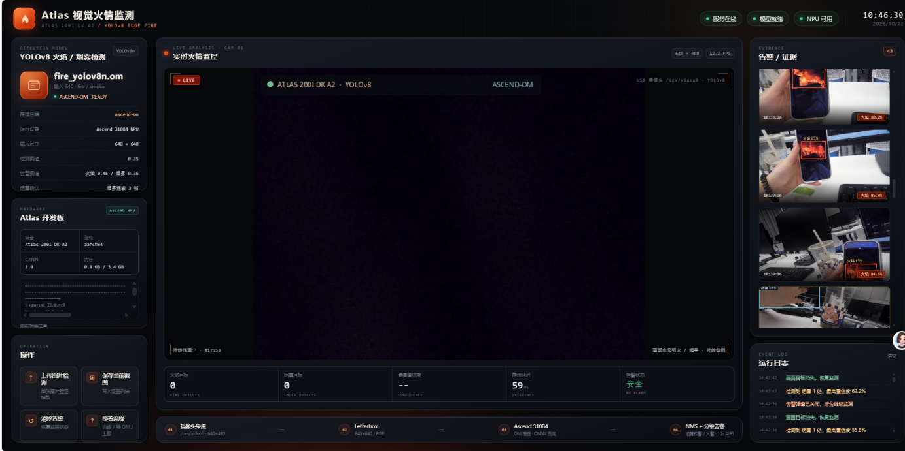
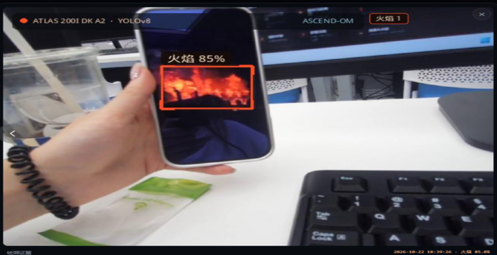

# Atlas 200I DK A2 视觉火情监测（火焰 + 烟雾）

> 华为 Atlas 200I DK A2（Ascend 310B4）独立工程
> PC 训练 YOLOv8 → 导出 ONNX → 板端 ATC 转 OM → 复制运行包上板
> 只保留摄像头 → 模型 → 分级告警 → 证据这一条独立链路。
>
> **双类别**：`0=fire 火焰`、`1=smoke 烟雾`；烟雾走一级"烟雾预警"（早期），
> 火焰走二级"火情告警"，烟雾期间出现明火会自动升级。

> **作者**：郑伟（厦门工学院 · 人工智能）
> **定位**：边缘端视觉火情监测作品 —— PC 训练 → ONNX → ATC → OM → 板端实时推理



> 上图为 PC 端"CPU 调试模式"的真实截图：模型是 `models/fire_yolov8n.onnx`，
> 画面来自 D-Fire 验证集，指标栏的火焰/烟雾框数、置信度、延迟都是当帧实测值。
> 板端换成 OM 后端时左上角会显示 `ASCEND-OM`。

实机检测（摄像头对准播放火焰视频的手机屏幕，板端实时框出并给出置信度）：



📖 **第一次上手先看 [docs/操作手册.md](docs/操作手册.md)** —— 从装环境、接摄像头、
跑训练到上板验收，每一步都有可直接复制的命令和常见报错处理。

---

## 1. 项目边界

| 内容 | 是否包含 | 说明 |
|---|---|---|
| 训练/部署代码 | ✅ | 本仓库 |
| 数据集 | ❌ | 使用者自行准备，**不打包进板端**；推荐 D-Fire（见 3.1） |
| 训练好的模型 | ✅ | 已训练并导出 `models/fire_yolov8n.onnx`（11.70 MB），随仓库提供，可直接跑 CPU 调试；板端 `models/fire_yolov8n.om` 需用 `deployment/convert_om.sh` 自行转换 |
| 板端 Web + 推理代码 | ✅ | `app/` |
| 数据集下载/划分/校验脚本 | ✅ | `training/download_dataset.py`、`prepare_dataset.py` |
| ATC/打包/安装脚本 | ✅ | `deployment/` |
| AI 模型精度数据 | ✅ | 在 D-Fire 全量上实测，见下表 |

**实测指标**（YOLOv8n、640、100 轮、D-Fire 21,527 张）：

| 划分 | mAP50 | mAP50-95 | P | R | 火焰 mAP50 | 烟雾 mAP50 |
|---|---|---|---|---|---|---|
| 验证集（3,445 张） | 0.778 | 0.445 | 0.784 | 0.719 | 0.710 | 0.846 |
| 测试集（4,306 张） | 0.780 | 0.434 | 0.776 | 0.716 | 0.717 | 0.842 |

ONNX 在 PC CPU 上 10.6 ms/帧（94.5 FPS）。火焰指标低于烟雾不是搞反了类别：
D-Fire 里火焰框的中位面积只有画面 0.87%，烟雾是 13.5%，属典型小目标检测问题。

项目目录中的 `samples/` 只是 UI/单图接口测试用的少量图片，不是训练数据集。

## 2. 整体流程

```text
PC（训练）                                         Atlas 200I DK A2（推理）
┌─────────────────────────┐                      ┌─────────────────────────┐
│ dataset/ (YOLO 格式)     │                      │ deployment/start.sh      │
│   ↓ prepare_dataset.py   │                      │   ↓                     │
│ YOLOv8n 训练 train.py    │                      │ Flask Web :8000          │
│   ↓ evaluate.py          │                      │   ↓ SSE /api/stream      │
│ best.pt                  │                      │ USB 摄像头               │
│   ↓ export_onnx.py       │   scp 运行包          │   ↓ letterbox 640         │
│ fire_yolov8n.onnx        │ ───────────────────► │ Ascend 310B4 / OM        │
│   ↓ package_for_board.py │  （不含 dataset）      │   ↓ NMS / 告警           │
└─────────────────────────┘                      │ 证据截图 + 网页          │
                                                  └─────────────────────────┘
```

关键点：

- 数据集、`runs/`、`training/` **不会进入板端包**；
- 板端只需要 `app/`、`configs/app.json`、`models/`、`deployment/`；
- 板端只有 4GB 内存，训练不在板端做，推理使用 YOLOv8n + 640 输入；
- OM 由 ATC 在板端（或 PC 的 CANN 环境）转换，`soc_version=Ascend310B4`；
- 没有 OM 时自动退到 ONNX Runtime CPU，页面会显示当前后端。

## 3. 快速开始

### 3.1 PC 训练端

```bash
cd edge_fire
python -m venv .venv-train
# Windows: .venv-train\Scripts\activate
# Linux/macOS: source .venv-train/bin/activate
pip install -r requirements/train.txt
```

准备数据集（不放也行，先看代码；训练必须有数据）：

推荐直接用公开的 **D-Fire**（21,527 张、26,557 个框，YOLO 格式，`0=fire, 1=smoke`）：
<https://github.com/gaiasd/DFireDataset>，下载页取
"D-Fire dataset (only images and labels)" 的压缩包。

```text
dataset/
├─ images/train  images/val
└─ labels/train  labels/val
```

```bash
# 一条命令：解压 + 校验类别 + 归一化 + 划分 train/val
python training/download_dataset.py --zip D:/downloads/DFireDataset.zip
# 只想先跑通流程
python training/download_dataset.py --zip D:/downloads/DFireDataset.zip --limit 2000

# 已有图片时手动划分
python training/prepare_dataset.py --dataset dataset --val-ratio 0.2

python training/train.py --device 0
python training/evaluate.py --weights runs/fire/yolov8n_fire/weights/best.pt --split test
python training/sweep_conf.py --weights runs/fire/yolov8n_fire/weights/best.pt
python training/export_onnx.py --weights runs/fire/yolov8n_fire/weights/best.pt
```

产物：

```text
models/fire_yolov8n.onnx
models/fire_yolov8n.meta.json
```

### 3.2 生成板端包（排除数据集）

```bash
python deployment/package_for_board.py --model models/fire_yolov8n.onnx
```

输出 `dist/atlas_fire_board_*.tar.gz`。脚本会检查归档内容，`dataset/`、`runs/`、
`training/` 不会被打包。

### 3.3 上板

```bash
# PC -> 板端（IP 以实际为准：Type-C 192.168.0.2 / 网口 192.168.137.100）
scp dist/atlas_fire_board_*.tar.gz root@192.168.137.100:/home/root/

ssh root@192.168.137.100
cd /home/root
tar -xzf atlas_fire_board_*.tar.gz
cd atlas_fire
bash deployment/install_board.sh
bash deployment/convert_om.sh       # 生成 models/fire_yolov8n.om
bash deployment/start.sh
```

浏览器打开：

```text
http://<板端IP>:8000/
```

详细登录、IP、CANN、ATC、FAQ 见 [docs/板端部署.md](docs/板端部署.md)。

## 4. 目录结构

```text
edge_fire/
├─ app/
│  ├─ main.py                  # Flask 应用、REST/SSE、应用工厂
│  ├─ stream.py                # 持续推理线程 + SSE
│  ├─ camera.py                # USB/目录/单图
│  ├─ annotate.py              # 中文火焰/烟雾框 + 类别计数 + 证据图
│  ├─ monitor.py               # 分级告警（烟雾预警/火情告警）+ 冷却 + 证据索引
│  ├─ system_info.py           # npu-smi / CANN / 内存
│  └─ detector/
│     ├─ preprocess.py         # letterbox / NCHW
│     ├─ postprocess.py        # YOLOv8/v5 解码 + NMS
│     ├─ om_backend.py         # Ascend 310B4 OM（ais_bench）
│     ├─ onnx_backend.py       # ONNX Runtime CPU 兜底（含类别数校验）
│     └─ factory.py            # auto: OM → ONNX → 未就绪
├─ configs/
│  ├─ app.json                 # 板端运行配置（双类别阈值/确认帧）
│  ├─ train.yaml               # 训练超参（含火焰烟雾增强策略）
│  └─ dataset.example.yaml
├─ training/
│  ├─ download_dataset.py      # 公开数据集导入（D-Fire 等，校验+抽样+划分）
│  ├─ prepare_dataset.py       # 数据校验/划分
│  ├─ train.py                 # YOLOv8 训练（含 per-class 指标）
│  ├─ evaluate.py              # mAP/P/R（按类输出）
│  ├─ sweep_conf.py            # 置信度阈值标定（生成阈值依据表）
│  ├─ export_onnx.py           # ONNX 导出 + meta
│  └─ benchmark.py             # PC ONNX 基准
├─ tools/
│  ├─ verify_classes.py        # 抽查类别映射是否搞反（HSV 统计）
│  ├─ make_demo.py             # 用真实权重生成 docs/真实检测样例.jpg
│  ├─ capture_ui.js            # CDP 截图（开发验证）
│  └─ check_board.py
├─ deployment/
│  ├─ convert_om.sh            # ATC
│  ├─ package_for_board.py     # 打包（排除 dataset）
│  ├─ install_board.sh
│  ├─ start.sh
│  └─ atlas-fire.service
├─ models/                     # 放 .onnx / .om / labels
├─ dataset/                    # 只放 README，不含数据
├─ samples/                    # UI 测试图片，非数据集
├─ tests/                      # 单元测试 + UI 预览
├─ docs/                       # 板端部署 + 设计报告
└─ requirements/
   ├─ train.txt                # PC 训练
   └─ board.txt                # 板端运行
```

## 5. 板端推理实现

1. **采集**：OpenCV 打开 `/dev/video0`，后台线程保留最新帧；无摄像头时可回退到
   单张演示图，但板端正式运行使用 USB 摄像头。
2. **预处理**：等比例 letterbox 到 640×640，BGR→RGB、/255、NCHW float32。
3. **推理**：
   - `ascend-om`：CANN `ais_bench.infer.interface.InferSession` 加载 `.om`；
   - `onnx-cpu`：ONNX Runtime CPU，作为板端兜底 / PC 调试；
   - `auto`：优先 OM，其次 ONNX，都没有则页面提示“模型未就绪”，服务不崩溃。
4. **后处理**：支持 YOLOv8 `[1,4+nc,N]` 与 YOLOv5 `[1,N,5+nc]` 输出，置信度过滤、
   NMS、letterbox 反变换、坐标裁剪。ONNX 加载时校验输出列数与 `labels.txt` 类别数，
   不一致直接报错（避免 1 类模型被按 2 类解码的静默错位）。
5. **分级告警**：
   - 火焰 → 二级"火情告警"，阈值 0.45，1 帧即确认；
   - 烟雾 → 一级"烟雾预警"，阈值 0.35，需**连续 3 帧**过阈值才确认（蒸汽/雾霾不会
     因为单帧抖动就报警）；
   - 烟雾预警期间出现明火 → 不等冷却直接升级到二级；
   - 命中消失后保持 6 秒再回落，10 秒冷却内不重复报；证据 JPEG 与索引持久化，
     事件记录含 `level / label / counts`。
6. **展示**：SSE 推送 base64 标注图 + JSON；页面展示火焰/烟雾计数、分级状态、
   后端、设备、CANN、FPS、延迟。
7. **单图验证**：上传图片调用同一后端，返回标注图与按类统计的目标列表。

告警策略在 `configs/app.json` 的 `alarm` 段可调：

```json
"alarm": {
  "class_names": ["fire", "smoke"],
  "thresholds": {"fire": 0.45, "smoke": 0.35},
  "confirm_frames": {"fire": 1, "smoke": 3},
  "cooldown_seconds": 10,
  "hold_seconds": 6,
  "escalate": true
}
```

> 如果板端镜像没有 `ais_bench`，会明确报错并回退 ONNX；不会静默假推理。

## 6. API

| 方法 | 路径 | 说明 |
|---|---|---|
| GET | `/api/health` | 模型/摄像头/NPU/CANN/告警状态 |
| GET | `/api/config` | 阈值、模型、摄像头摘要 |
| GET | `/api/stream` | SSE 实时检测流 |
| POST | `/api/detect` | multipart `file`，单图检测 |
| POST | `/api/snapshot` | 保存当前画面（或上传 `file`） |
| GET | `/api/events` | 证据列表 |
| GET | `/api/events/<id>` | 证据图片 |
| POST | `/api/alarm/clear` | 清除告警状态 |
| GET | `/api/board` | 强制刷新 `npu-smi`/CANN/内存 |

示例：

```bash
curl http://127.0.0.1:8000/api/health
curl -F "file=@samples/fire_phone.jpg" http://127.0.0.1:8000/api/detect
curl -X POST http://127.0.0.1:8000/api/alarm/clear
```

## 7. 测试

```bash
python -m unittest discover -s tests -v
```

当前覆盖：

- letterbox 反变换、YOLOv8 单/双类输出、YOLOv5 objectness、NMS；
- 双类别分级告警：烟雾 3 帧确认、计数清零、明火升级、保持与回落、证据标签；
- 类别一致性：`labels.txt` / `app.json` / `dataset.yaml` 三处对齐；
- Flask `/api/health`、`/api/config`、单图检测、证据图片；
- 数据集扁平划分与标注校验。

结果：**27 项全部通过**。这些测试不依赖真实数据集或模型（模型精度见上面的
"实测指标"表，由 `training/evaluate.py` 在 D-Fire 测试集上跑出）。

界面预览（真实 ONNX 模型 + D-Fire 真实图片，PC CPU 调试模式）：


## 8. 重要说明

- **不含数据集，含推理模型**：数据集不随仓库分发（推荐 D-Fire），但
  `models/fire_yolov8n.onnx` 已随仓库提供，克隆后可直接以 ONNX-CPU 后端运行看效果。
  板端 OM 由 `deployment/convert_om.sh` 从该 ONNX 转换得到，仓库不存转换产物。
- **双类别**：`models/labels.txt` 为 `fire` / `smoke` 两行，改动类别顺序必须同步
  `configs/app.json` 的 `class_names` 与训练时的 `names`。
- **独立工程**：只依赖 `app/` 的推理与 Web 服务，不引入外部应用框架；目录和接口
  都是围绕 Atlas 板端部署重新设计的。
- **上板不带数据集**：`package_for_board.py` 明确排除 `dataset/`、`runs/`、
  `training/`，并在 `manifest.json` 写 `dataset_included: false`。
- **Atlas 200I DK A2 4GB**：建议 YOLOv8n、640、batch=1；关闭图形桌面可省约 400MB。
- **安全**：课程原型不能替代消防认证设备；真实部署需要人工复核与消防联动。

更多：

- [docs/板端部署.md](docs/板端部署.md)
- [docs/操作手册.md](docs/操作手册.md)

> 训练脚本与课程设计报告位于原始开发工程，未随本仓库分发；本仓库聚焦"模型 → 板端推理 → 分级告警 → Web 展示"这条完整部署链路。
